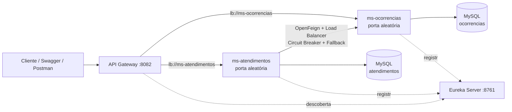

# Caminho Livre — Microsserviços

> Calçadas acessíveis começam com quem anda nelas.

Global Solution 2026.2 — **CitizenTech** · Microservice and Web Engineering & IT Services (Prof.ª Aparecida F. Castello Rosa)

## Integrantes — Equipe Sem Degrau

| RM | Nome |
|---|---|
| RM559149 | Maria Eduarda Fiori |
| RM557578 | Henrique Maion |
| RM557624 | Nilton Eberlein |

## Problema

Calçadas quebradas, esquinas sem rampa, postes no meio do caminho e semáforos sem sinal sonoro impedem pessoas com deficiência ou mobilidade reduzida de circular pela cidade. Segundo o Censo 2022 do IBGE, 68,8% dos moradores de áreas urbanas vivem em vias sem rampa para cadeirante, e o Brasil tem 14,4 milhões de pessoas com deficiência.

Hoje esses problemas chegam à prefeitura de forma dispersa e sem critério de prioridade, então o que mais atrapalha nem sempre é resolvido primeiro.

## Solução

O **Caminho Livre** recebe o registro das barreiras de acessibilidade feito pelos cidadãos e organiza uma fila ordenada pelo impacto na mobilidade. A equipe da prefeitura abre um atendimento (ordem de serviço) para cada barreira e, ao concluí-lo, a ocorrência passa a constar como resolvida.

Índice de prioridade de cada ocorrência:

```
índice = gravidade (1 a 5) × fator de entorno (1 a 3) + 0,5 por confirmação de morador (máximo + 3)
```

O fator de entorno é **3** quando a barreira está a até 150 m de um hospital, escola ou ponto de ônibus, **2** entre 150 m e 400 m e **1** nos demais casos. Exemplo: rampa ausente (gravidade 4) perto de um hospital (fator 3) com 5 confirmações → 4 × 3 + 2,5 = **14,5**.

A solução tem dois microsserviços com comunicação síncrona:

| Microsserviço | Responsabilidade | Banco |
|---|---|---|
| `ms-ocorrencias` | Registro das barreiras, cálculo do índice, fila por prioridade e **status da ocorrência** | `ocorrencias` |
| `ms-atendimentos` | Ordens de serviço da prefeitura. Ao abrir, concluir ou cancelar um atendimento, **altera o status da ocorrência no `ms-ocorrencias` via OpenFeign** | `atendimentos` |

### Status alterado pela comunicação síncrona

| Ação no `ms-atendimentos` | Chamada OpenFeign ao `ms-ocorrencias` | Status da ocorrência |
|---|---|---|
| `POST /api/v1/atendimentos` (abre o atendimento) | `PUT /api/v1/ocorrencias/{id}/em-atendimento` | `ABERTA` → `EM_ATENDIMENTO` |
| `PATCH /api/v1/atendimentos/{id}/concluir` | `PUT /api/v1/ocorrencias/{id}/resolvida` | `EM_ATENDIMENTO` → `RESOLVIDA` |
| `PATCH /api/v1/atendimentos/{id}/cancelar` | `PUT /api/v1/ocorrencias/{id}/reaberta` | `EM_ATENDIMENTO` → `ABERTA` |

O status do atendimento também muda: `AGENDADO` → `CONCLUIDO` ou `CANCELADO`. Se o `ms-ocorrencias` estiver fora do ar ao concluir, o fallback deixa o atendimento como `CONCLUSAO_PENDENTE`, e ele pode ser concluído (ou cancelado) depois.

## Arquitetura



- **Eureka Server (8761):** registro e descoberta dos serviços.
- **API Gateway (8082):** porta de entrada única. As rotas são criadas a partir do Eureka (`/ms-ocorrencias/**` e `/ms-atendimentos/**`), sem URLs fixas. Também reúne o Swagger dos dois microsserviços.
- **OpenFeign + Load Balancer:** o `ms-atendimentos` chama o `ms-ocorrencias` pelo nome registrado no Eureka (`@FeignClient(name = "ms-ocorrencias")`), e o Load Balancer escolhe uma das instâncias.
- **Circuit Breaker (Resilience4j) + Fallback:** o endpoint `PATCH /api/v1/atendimentos/{id}/concluir` tem `@CircuitBreaker(name = "atualizarOcorrencia", fallbackMethod = "fallbackConcluirAtendimentoPendente")`. Se o `ms-ocorrencias` estiver indisponível, o fallback grava o atendimento como **`CONCLUSAO_PENDENTE`** e devolve **503** com o atendimento no corpo. Depois de algumas falhas, o circuito abre e as chamadas seguintes vão direto para o fallback. Passados 50 s, ele testa de novo (HALF_OPEN). Quando o `ms-ocorrencias` volta, basta chamar `/concluir` de novo.
- **Tratamento das respostas do Feign** no `AtendimentoService`: 404 do `ms-ocorrencias` vira "Ocorrência não encontrada" (404), 409 vira regra de negócio (409) e as demais falhas viram "Falha ao comunicar com ms-ocorrencias" (503).
- **Porta aleatória (`server.port=0`)** nos microsserviços, para subir várias instâncias.
- **Bancos independentes:** cada microsserviço tem o próprio banco (`ocorrencias` e `atendimentos`), criado e populado pelo **Flyway**.

### Camadas de cada microsserviço

```
controller  -> recebe as requisições (ResponseEntity, códigos HTTP, URI no POST)
service     -> regras de negócio, CRUD e exceções customizadas
repository  -> acesso ao banco (Spring Data JPA)
entities    -> entidades JPA e enums de status
dto         -> RequestDTO (entrada) e ResponseDTO (saída)
exceptions  -> exceções customizadas e GlobalExceptionHandler
config      -> OpenApiConfig (Swagger)
client      -> OcorrenciaClient (OpenFeign)   [somente ms-atendimentos]
```

## Tecnologias

| Componente | Versão |
|---|---|
| Java | 25 |
| Spring Boot | 4.0.9 |
| Spring Cloud | 2025.1.4 (Eureka, Gateway, OpenFeign, LoadBalancer, CircuitBreaker Resilience4j) |
| Banco de dados | MySQL 8.4.6 (Docker) |
| Migrations | Flyway |
| Documentação | springdoc-openapi 3.1.0 (Swagger UI) |
| Outros | Spring Data JPA, Bean Validation, Lombok |

## Estrutura do repositório

```
caminho-livre-microservices/
├── eureka-server/          # Service Discovery (porta 8761)
├── api-gateway/            # API Gateway + Swagger dinâmico (porta 8082)
├── ms-ocorrencias/         # Microsserviço de ocorrências
├── ms-atendimentos/        # Microsserviço de atendimentos (OpenFeign)
├── compose/
│   └── docker-compose.yml  # Somente o MySQL (opção 1)
├── docker-compose.yml      # Solução completa em containers (opção 2)
└── README.md
```

## Como executar

### Pré-requisitos

- **JDK 25**
- **Docker Desktop** (para o MySQL)
- **IntelliJ IDEA** ou Maven. Cada projeto tem o Maven Wrapper (`mvnw` / `mvnw.cmd`), então não é preciso instalar o Maven.
- Portas livres: **3306** (MySQL), **8761** (Eureka) e **8082** (Gateway).

### Opção 1 — MySQL no Docker e serviços pelo IntelliJ ou Maven (recomendada)

**1. Clonar o repositório**

```bash
git clone https://github.com/Mai0n/caminho-livre-microservices.git
cd caminho-livre-microservices
```

**2. Subir o MySQL**

```bash
docker compose -f compose/docker-compose.yml up -d
```

O container `mysql_846` sobe na porta 3306, com usuário `root` e senha `root`. Os bancos `ocorrencias` e `atendimentos` são criados automaticamente quando cada microsserviço inicia (`createDatabaseIfNotExist=true`), e o Flyway cria as tabelas e insere os dados iniciais.

**3. Subir os serviços nesta ordem**, cada um em um terminal (ou pelo botão Run do IntelliJ, abrindo cada pasta como projeto):

```bash
# Terminal 1 — Eureka Server
cd eureka-server
./mvnw spring-boot:run

# Terminal 2 — API Gateway
cd api-gateway
./mvnw spring-boot:run

# Terminal 3 — ms-ocorrencias
cd ms-ocorrencias
./mvnw spring-boot:run

# Terminal 4 — ms-atendimentos
cd ms-atendimentos
./mvnw spring-boot:run
```

No Windows (PowerShell ou CMD), use `.\mvnw.cmd spring-boot:run` no lugar de `./mvnw spring-boot:run`.

**4. Conferir no Eureka:** em http://localhost:8761 devem aparecer `API-GATEWAY`, `MS-OCORRENCIAS` e `MS-ATENDIMENTOS`.

**5. Abrir o Swagger:** http://localhost:8082/swagger-ui/index.html e escolher o microsserviço no seletor do topo. Os serviços aparecem no Swagger até 10 segundos depois de se registrarem no Eureka.

#### Múltiplas instâncias

Como os microsserviços usam porta aleatória, basta executar o mesmo comando em outro terminal (por exemplo, `cd ms-ocorrencias` e `./mvnw spring-boot:run` de novo). No IntelliJ, marque *Modify options → Allow multiple instances* na configuração de execução. As instâncias aparecem no Eureka, e o Gateway e o OpenFeign distribuem as chamadas entre elas.

Para ver o balanceamento, chame várias vezes `http://localhost:8082/ms-ocorrencias/api/v1/ocorrencias/port`: a resposta mostra uma porta diferente a cada instância ("Instância respondeu na porta 54371").

### Opção 2 — Solução completa no Docker

Na raiz do repositório:

```bash
docker compose up -d --build
```

Sobe o MySQL, o Eureka, o Gateway e os dois microsserviços, cada um a partir do seu `Dockerfile`. O primeiro build demora alguns minutos. Os endereços são os mesmos: http://localhost:8761 e http://localhost:8082/swagger-ui/index.html.

Para parar: `docker compose down`. Se a opção 1 estiver rodando, pare antes o MySQL dela com `docker compose -f compose/docker-compose.yml down`.

## Endpoints

Todos os endpoints podem ser chamados pelo Gateway (`http://localhost:8082/{serviço}/...`) ou testados pelo Swagger.

### ms-ocorrencias — `http://localhost:8082/ms-ocorrencias/api/v1/ocorrencias`

| Método | Rota | Descrição | Retorno |
|---|---|---|---|
| GET | `/api/v1/ocorrencias` | Lista as ocorrências da maior para a menor prioridade | 200 |
| GET | `/api/v1/ocorrencias/port` | Porta da instância que respondeu (teste do Load Balancer) | 200 |
| GET | `/api/v1/ocorrencias/{id}` | Busca por ID | 200 / 404 |
| POST | `/api/v1/ocorrencias` | Registra uma ocorrência (status `ABERTA`, índice calculado) | 201 + Location / 422 |
| PUT | `/api/v1/ocorrencias/{id}` | Atualiza os dados e recalcula o índice | 200 / 404 / 422 |
| DELETE | `/api/v1/ocorrencias/{id}` | Exclui (não permitido se `EM_ATENDIMENTO`) | 204 / 404 / 409 |
| PATCH | `/api/v1/ocorrencias/{id}/confirmar` | Morador confirma a barreira (+0,5 no índice) | 200 / 404 / 409 |
| PUT | `/api/v1/ocorrencias/{id}/em-atendimento` | `ABERTA` → `EM_ATENDIMENTO` (chamado pelo ms-atendimentos) | 200 / 404 / 409 |
| PUT | `/api/v1/ocorrencias/{id}/resolvida` | `EM_ATENDIMENTO` → `RESOLVIDA` (chamado pelo ms-atendimentos) | 200 / 404 / 409 |
| PUT | `/api/v1/ocorrencias/{id}/reaberta` | `EM_ATENDIMENTO` → `ABERTA` (chamado pelo ms-atendimentos) | 200 / 404 / 409 |

Exemplo de corpo para POST e PUT:

```json
{
  "tipoBarreira": "RAMPA_AUSENTE",
  "descricao": "Não há rampa na esquina. Cadeirantes precisam descer pela rua.",
  "logradouro": "Avenida do Hospital",
  "bairro": "Centro",
  "cep": "01001-000",
  "gravidade": 4,
  "fatorEntorno": 3
}
```

Tipos de barreira: `CALCADA_QUEBRADA`, `RAMPA_AUSENTE`, `OBSTACULO`, `POSTE_NA_CALCADA`, `SEMAFORO_SEM_SOM` e `OUTRA`.

### ms-atendimentos — `http://localhost:8082/ms-atendimentos/api/v1/atendimentos`

| Método | Rota | Descrição | Retorno |
|---|---|---|---|
| GET | `/api/v1/atendimentos` | Lista os atendimentos | 200 |
| GET | `/api/v1/atendimentos/port` | Porta da instância que respondeu (teste do Load Balancer) | 200 |
| GET | `/api/v1/atendimentos/{id}` | Busca por ID | 200 / 404 |
| POST | `/api/v1/atendimentos` | Abre o atendimento (status `AGENDADO`) e coloca a ocorrência `EM_ATENDIMENTO` | 201 + Location / 404 / 409 / 422 / 503 |
| PUT | `/api/v1/atendimentos/{id}` | Atualiza equipe, serviço e data prevista (somente `AGENDADO`) | 200 / 404 / 409 / 422 |
| DELETE | `/api/v1/atendimentos/{id}` | Exclui (não permitido se `AGENDADO` ou `CONCLUSAO_PENDENTE`) | 204 / 404 / 409 |
| PATCH | `/api/v1/atendimentos/{id}/concluir` | Conclui e marca a ocorrência como `RESOLVIDA`. Com Circuit Breaker: se o `ms-ocorrencias` estiver fora, fica `CONCLUSAO_PENDENTE` | 200 / 404 / 409 / 503 |
| PATCH | `/api/v1/atendimentos/{id}/cancelar` | Cancela e devolve a ocorrência para `ABERTA` | 200 / 404 / 409 / 503 |

Exemplo de corpo para POST e PUT:

```json
{
  "ocorrenciaId": 1,
  "equipeResponsavel": "Equipe de Obras Viárias - Centro",
  "descricaoServico": "Construção de rampa de acessibilidade na esquina",
  "dataPrevista": "2026-12-01"
}
```

`dataPrevista` não pode estar no passado.

### Códigos de erro

| Código | Quando |
|---|---|
| 400 | JSON malformado, valor de enum inválido ou parâmetro com tipo errado |
| 404 | Recurso não encontrado |
| 409 | Regra de negócio: o status atual não permite a operação |
| 422 | Dados inválidos (Bean Validation), com a lista de campos e mensagens |
| 503 | `ms-ocorrencias` indisponível. No `/concluir`, o fallback devolve o atendimento com status `CONCLUSAO_PENDENTE` |

## Roteiro de teste

Os dados iniciais do Flyway já deixam o sistema pronto para testar:

- **Ocorrências:** 7 registros. A de ID 1 (rampa ausente, índice 14,5) está `ABERTA`, a de ID 2 está `EM_ATENDIMENTO` e as de ID 6 e 7 estão `RESOLVIDA`.
- **Atendimentos:** 3 registros. O de ID 1 (da ocorrência 2) está `AGENDADO`, e os de ID 2 e 3 estão `CONCLUIDO`.

1. **Fila por prioridade:** `GET /ms-ocorrencias/api/v1/ocorrencias`. A ocorrência ID 1 (índice 14,5) vem primeiro.
2. **Abrir atendimento (comunicação síncrona):** `POST /ms-atendimentos/api/v1/atendimentos` com `"ocorrenciaId": 1`. Retorna **201** com o header `Location`. Depois, `GET /ms-ocorrencias/api/v1/ocorrencias/1` mostra `"status": "EM_ATENDIMENTO"`.
3. **Concluir atendimento:** `PATCH /ms-atendimentos/api/v1/atendimentos/{id}/concluir` com o ID criado no passo 2. O atendimento fica `CONCLUIDO`, e a ocorrência 1 passa a `RESOLVIDA`.
4. **Cancelar atendimento:** `PATCH /ms-atendimentos/api/v1/atendimentos/1/cancelar`. O atendimento fica `CANCELADO`, e a ocorrência 2 volta a `ABERTA`.
5. **Regra de negócio (409):** repita o passo 3 com o mesmo ID. O atendimento já está `CONCLUIDO`.
6. **Ocorrência inexistente (404 pelo Feign):** `POST /ms-atendimentos/api/v1/atendimentos` com `"ocorrenciaId": 999`.
7. **Validação (422):** `POST /ms-ocorrencias/api/v1/ocorrencias` com `"gravidade": 9` e `"descricao": "curta"`.
8. **Circuit Breaker e Fallback (503):**
   - Abra um atendimento novo para a ocorrência 3 (`POST` com `"ocorrenciaId": 3`).
   - Pare o `ms-ocorrencias` e chame `PATCH /ms-atendimentos/api/v1/atendimentos/{id}/concluir`. A resposta é **503** com o atendimento no corpo e `"status": "CONCLUSAO_PENDENTE"`, e o log do `ms-atendimentos` mostra "Ativando fallback".
   - Repita a chamada algumas vezes: o circuito abre e a resposta vem na hora, sem tentar o `ms-ocorrencias`.
   - Suba o `ms-ocorrencias` de novo e, depois de 50 s, chame `/concluir` mais uma vez: o atendimento fica `CONCLUIDO` e a ocorrência 3 passa a `RESOLVIDA`.

Para conferir os dados direto no MySQL:

```bash
docker exec -it mysql_846 mysql -uroot -proot -e "SELECT id, tipo_barreira, status, indice_prioridade FROM ocorrencias.tb_ocorrencia; SELECT id, ocorrencia_id, status FROM atendimentos.tb_atendimento;"
```

## Migrations (Flyway)

| Microsserviço | Arquivo | Conteúdo |
|---|---|---|
| ms-ocorrencias | `V1__create_table_tb_ocorrencia.sql` | Cria a tabela `tb_ocorrencia` |
| ms-ocorrencias | `V2__insert_tb_ocorrencia.sql` | Carga inicial com 7 ocorrências |
| ms-atendimentos | `V1__create_table_tb_atendimento.sql` | Cria a tabela `tb_atendimento` |
| ms-atendimentos | `V2__insert_tb_atendimento.sql` | Carga inicial com 3 atendimentos |

Os arquivos ficam em `src/main/resources/db/migration` de cada microsserviço.
